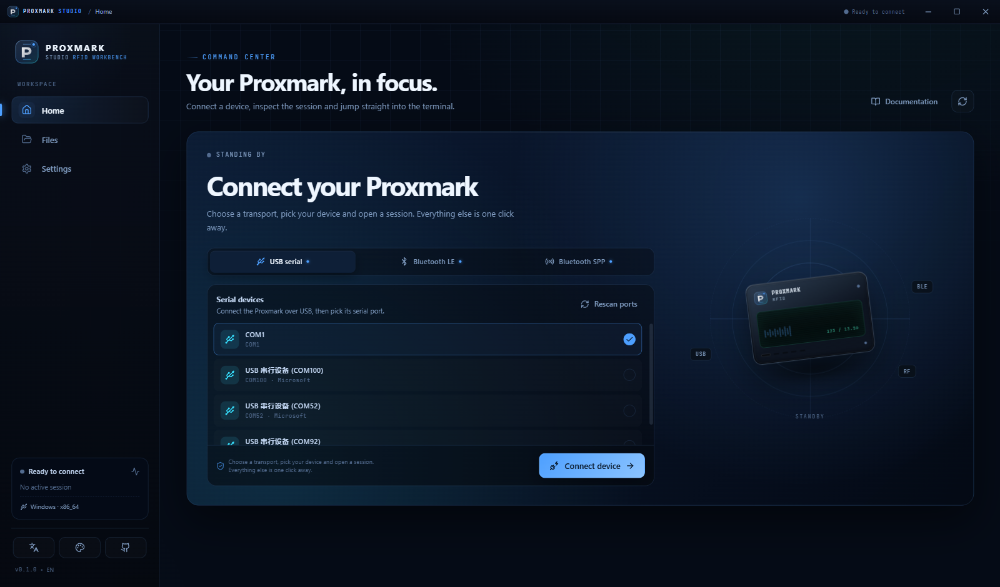
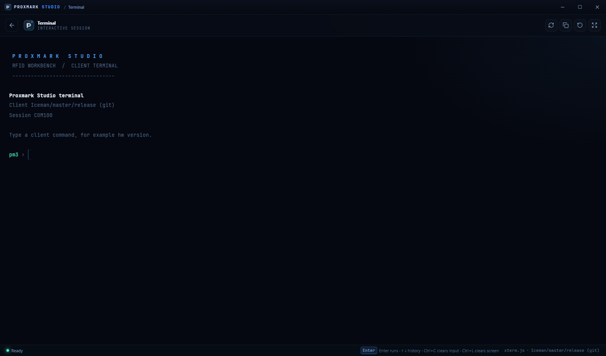
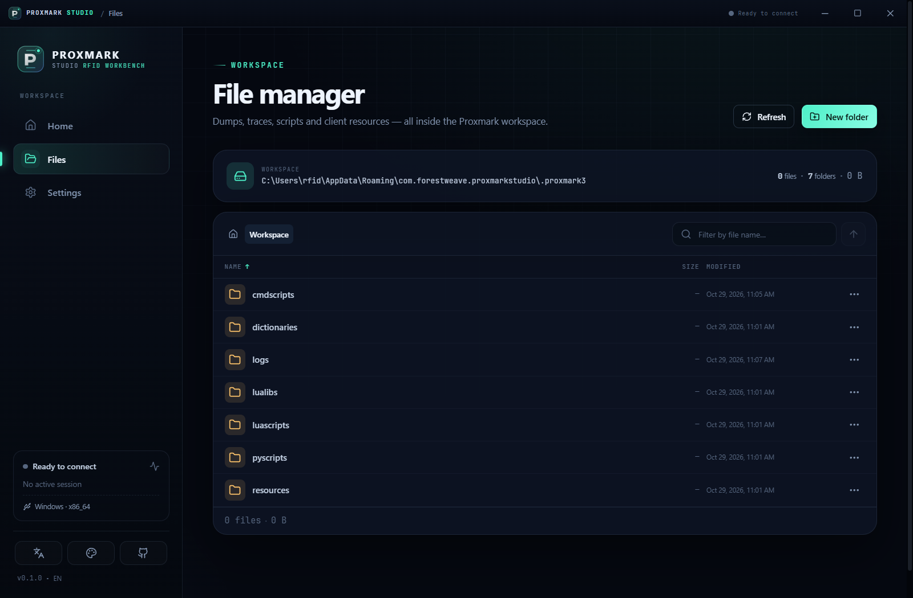
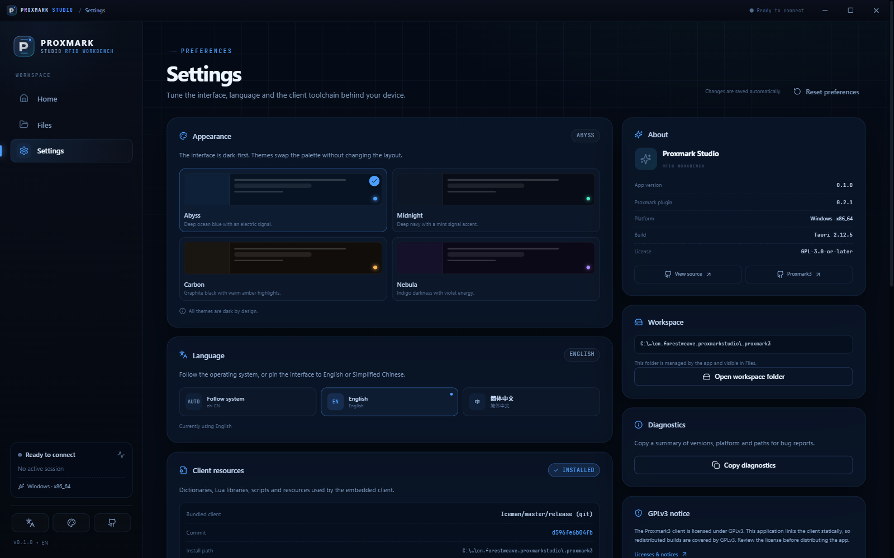
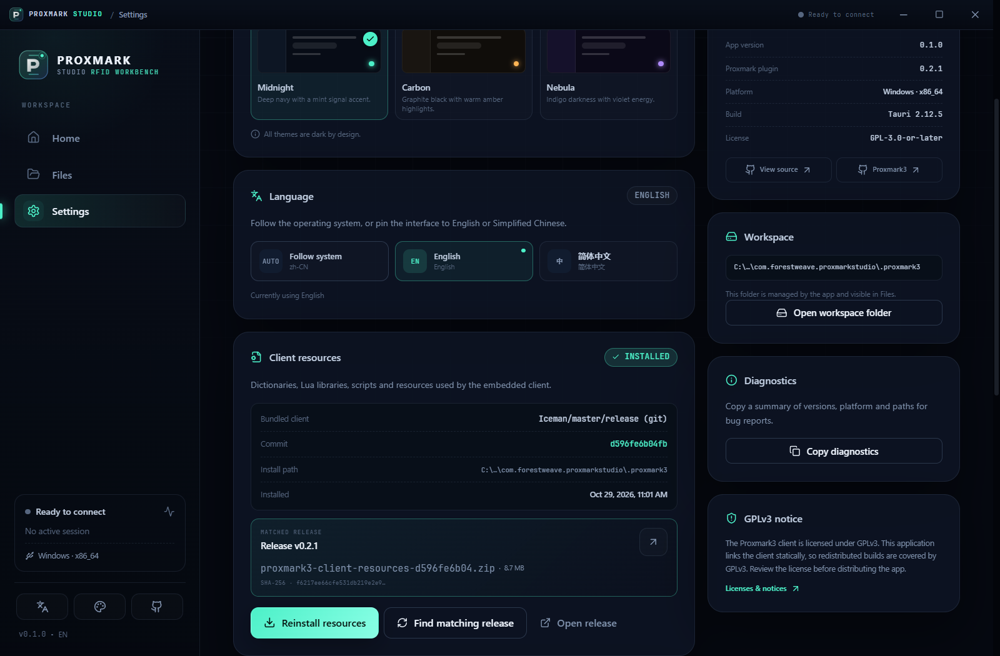

# Proxmark Studio

A cross-platform workbench for **Proxmark3 and Proxmark5** hardware, built with
[Tauri 2](https://v2.tauri.app/start/), Vue 3, Pinia and TypeScript.

**Source:** <https://github.com/RfidResearchGroup/ProxmarkStudio>  
**Issues:** <https://github.com/RfidResearchGroup/ProxmarkStudio/issues>

Proxmark Studio wraps the embedded Proxmark client from
[`tauri-plugin-proxmark3`](https://github.com/xianglin1998/tauri-plugin-proxmark3)
in a focused desktop/mobile interface: connect over USB serial, Bluetooth LE or
Bluetooth SPP, inspect the device, browse its working directory and run client
commands in an xterm.js terminal.

The UI is model-neutral. Device names, targets and transports are read from the
connected client at runtime, so the same build works with RDV4, GENERIC,
ULTIMATE, ICOPVX, Proxmark5 and other Proxmark variants.



## Features

- **Connect** over USB serial, Bluetooth LE or Bluetooth SPP where the platform
  and client support it. Unsupported transports are shown as unavailable rather
  than failing silently.
- **Device overview** with live hardware/client identification (`hw version`,
  `hw status`), transport, port and session details.
- **Integrated terminal** powered by xterm.js, with command history, streaming
  output and the same command grammar as the `pm3` client.
- **Workspace file manager**: browse the client's `~/.proxmark3` directory,
  preview text or hex, move files, create folders, delete and share/reveal.
- **Client resources** downloaded from the matching plugin GitHub release. The
  app resolves the release by the client commit, verifies SHA-256, and installs
  the archive into the client's user resource layout automatically.
- **Dark-first design** with four themes (Abyss blue by default), a desktop sidebar, a mobile tab bar,
  and a frameless desktop window with custom chrome.
- **English + Simplified Chinese**, following the system language by default and
  switchable in Settings.

| Desktop | Terminal | Files | Settings |
| --- | --- | --- | --- |
|  |  |  |  |

## Platform support

| Capability | Windows | macOS | Linux | Android | iOS |
| --- | --- | --- | --- | --- | --- |
| USB serial | Yes | Yes | Yes | Yes (CDC-ACM) | Unsupported by iOS |
| Bluetooth LE | Yes | Yes | Yes | Yes | Yes |
| Bluetooth SPP | Yes (paired COM) | Yes (paired serial) | Yes (paired rfcomm) | Yes (paired device) | Unsupported by iOS |
| Share sheet | Reveal in Explorer | Reveal in Finder | Open folder | Yes | Yes |
| Frameless desktop chrome | Yes | Yes | Yes | n/a | n/a |

The capability flags come from
[`src-tauri/src/system.rs`](src-tauri/src/system.rs). If a transport is not
available, its tab is disabled and the UI explains why; it is never offered as a
dead control.

> Android USB serial uses a native CDC-ACM bridge; Android SPP uses an RFCOMM
> socket. Both are exposed through the local loopback bridge, so the embedded
> client sees the same TCP transport it uses for BLE.

## Bluetooth LE

The app bridges BLE UART frames to a loopback TCP socket consumed by the
embedded client. This keeps the client transport layer unchanged while allowing
BLE on every platform supported by `tauri-plugin-blec`.

Auto-detection understands:

| Device | Service | Characteristic | Notes |
| --- | --- | --- | --- |
| Proxmark5 BWM ESP32 | `0xAE86` | `0xAE88` | Read + write + notify on one characteristic, per the [BWM DEV.md](https://github.com/RfidResearchGroup/Proxmark5_BWM_esp32/blob/master/DEV.md) |
| Nordic UART bridge | `6E400001-B5A3-F393-E0A9-E50E24DCCA9E` | RX `6E400002-B5A3-F393-E0A9-E50E24DCCA9E`, TX `6E400003-B5A3-F393-E0A9-E50E24DCCA9E` | Common third-party BLE add-ons |
| Generic UART | any | first write + notify pair | HM-10 and similar modules |

The Proxmark5 BWM values are the defaults in Settings. Custom service and
characteristic UUIDs can be entered there if auto-detection is not enough.

## How client resources are resolved

1. The app reads the compiled client version and extracts its git hash when one
   is present, falling back to the pinned commit in
   [`src-tauri/build.rs`](src-tauri/build.rs).
2. It walks the plugin's GitHub releases from newest to oldest and reads each
   release's `manifest.json`.
3. The first release whose `proxmark3.commit` matches is selected. The matching
   `proxmark3-client-resources-<commit>.zip` is downloaded from that release.
4. The archive is checked against the published SHA-256, extracted to a staging
   directory, and the `share/proxmark3/*` payload is installed into
   `~/.proxmark3` (user resource layout) so the client finds dictionaries,
   scripts and Lua libraries without any extra environment setup.
5. A hidden `.pm3-resources.json` marker records commit, version, asset and file
   count.



The app's app-data directory is used as `HOME` for the embedded client on every
platform. On Windows the C runtime's home is updated through the plugin bridge
itself so the statically linked client sees the same directory.

## Stack

- **Shell**: Tauri 2.12 (Rust), `tauri-plugin-proxmark3` 0.2.1 (static libpm3)
- **UI**: Vue 3.5, Pinia, Vue Router, Vite 6, TypeScript
- **Terminal**: `@xterm/xterm` + `@xterm/addon-fit`
- **Transport**: `tauri-plugin-blec` for BLE, serialport for USB/SPP discovery,
  and the local `tauri-plugin-transport` for Android USB CDC-ACM + Bluetooth SPP
- **Resources**: reqwest (rustls) + zip + sha2
- **Mobile sharing**: `tauri-plugin-share`

## Repository layout

```
src/                  Vue app (views, components, stores, services, i18n)
src-tauri/            Tauri/Rust backend and desktop configuration
  src/system.rs       platform capabilities, paths, serial discovery
  src/files.rs        sandboxed workspace file operations
  src/resources.rs    GitHub release matching + resource installer
  src/bridge.rs       loopback TCP bridge for BLE/USB/SPP frames
plugins/tauri-plugin-transport  Android USB CDC-ACM + Bluetooth SPP bridge
scripts/              frontend runner, plugin bootstrap, Windows/Android helpers
docs/screenshots/     UI captures
src-tauri/gen/android Android Studio project (committed for manifest tweaks)
_temp/                local toolchain/plugin cache, ignored by git
```

## Development

### Prerequisites

- Node.js 20+ and pnpm 9+
- Rust stable, with the **GNU** target on Windows (`x86_64-pc-windows-gnu`)
- CMake 3.19+, Ninja, a C/C++ toolchain
- Windows: MSYS2 UCRT64
  (`gcc`, `cmake`, `ninja`, `zlib`, `bzip2`, `lz4`)
- Linux: GTK/WebKitGTK development packages required by Tauri
- Android: JDK 17, Android SDK, NDK r27+ (NDK 21 lacks the `libunwind` that
  current Rust Android targets link against); iOS: macOS + Xcode

The embedded client is GPLv3 and only builds with the GNU ABI on Windows; MSVC
will fail with an explicit message from the plugin.

### Bootstrap

```bash
pnpm install
# Download the pinned plugin crate into _temp and apply the local compatibility
# patches (Cargo links key, Android CMake, CMake version fallback, GUI stdout
# capture, interactive stdin, static Windows libraries, Apple x86_64 SIMD).
powershell -ExecutionPolicy Bypass -File scripts/setup-plugin.ps1   # Windows
# or
bash scripts/setup-plugin.sh                                        # Linux/macOS
```

The plugin is intentionally not committed. `scripts/setup-plugin.*` pins the
release URL and SHA-256, so the source tree stays small and reproducible.

### Run on Windows

```powershell
# optional if MSYS2 is not at the default path
$env:PM3X_MINGW_BIN = 'C:\msys64\ucrt64\bin'

powershell -ExecutionPolicy Bypass -File scripts/tauri-windows.ps1          # development window
powershell -ExecutionPolicy Bypass -File scripts/tauri-windows.ps1 -Release # release exe
powershell -ExecutionPolicy Bypass -File scripts/tauri-windows.ps1 -Release -Bundle
```

```powershell
rustup toolchain install stable-x86_64-pc-windows-gnu
rustup target add x86_64-pc-windows-gnu
```

If you prefer the CLI directly:

```powershell
node node_modules/@tauri-apps/cli/tauri.js dev --target x86_64-pc-windows-gnu
node node_modules/@tauri-apps/cli/tauri.js build --target x86_64-pc-windows-gnu --no-bundle
```

The root `.cargo/config.toml` selects the GNU target's linker from `PATH`. The
build script and CI put the MSYS2 UCRT64 `bin` directory first; `PM3X_MINGW_BIN`
is still used by the plugin's build script to locate `gcc`, `g++` and the
MSYS2 bzip2/lz4 libraries. The Windows release links bzip2, lz4, zlib and
winpthread statically, so the produced `.exe` runs without MSYS2 installed.

### Automated builds

[`.github/workflows/build.yml`](.github/workflows/build.yml) builds and packages:

| Artifact | Runner | Output |
| --- | --- | --- |
| Windows x64 | `windows-latest` | NSIS installer + portable ZIP |
| macOS Intel | `macos-15-intel` | `.dmg` |
| macOS Apple Silicon | `macos-14` | `.dmg` |
| Linux x64 | `ubuntu-22.04` | AppImage + Debian package |
| Android arm64 | `ubuntu-latest` | debug APK |

The workflow runs on every push to `main`, pull requests, and manual dispatch.
Pushing a `v*` tag additionally publishes all packages to the GitHub release for
that tag. Builds are available as workflow artifacts for 14 days.

### Linux / macOS

```bash
pnpm install
bash scripts/setup-plugin.sh
pnpm tauri dev          # or: pnpm tauri build
```

On Linux, pair the device in the system Bluetooth settings and bind an rfcomm
port (`/dev/rfcomm*`). The app lists it alongside USB CDC ports; the embedded
client is built with Bluetooth transport support disabled, so SPP is handled
through the OS serial layer.

### Android

```bash
rustup target add aarch64-linux-android armv7-linux-androideabi x86_64-linux-android
# generated project is committed, so no `android init` is required
pnpm tauri android dev
# or, on Windows, use the environment helper:
powershell -ExecutionPolicy Bypass -File scripts/tauri-android.ps1 -Debug -Apk
```

If you keep the NDK under `_temp/android-ndk/android-ndk-r27c`,
`scripts/tauri-android.ps1` finds it automatically. Otherwise set `NDK_HOME` to
an r27+ installation. The script also discovers the Android SDK from
`ANDROID_HOME`, `ANDROID_SDK_ROOT`, or the standard per-user SDK location, and
finds a JDK 17+ from `JAVA_HOME` or the usual Program Files locations.

Android USB serial is implemented by the local `tauri-plugin-transport` crate:
it opens CDC-ACM bulk endpoints, bridges them to the loopback TCP transport, and
exposes paired-classic Bluetooth devices over RFCOMM SPP the same way. The
plugin requests USB access on first use; Android shows its standard permission
dialog.

The generated Android project lives in
[`src-tauri/gen/android`](src-tauri/gen/android) and is committed because the
manifest carries the share `FileProvider` and the resource paths used by the
app. It uses `compileSdk = 36` (required by the current AndroidX/plugin
libraries) and `minSdk = 26` (required by `tauri-plugin-blec`). Bump these when
you upgrade the Android toolchain.

Android BLE runtime permissions are provided by `tauri-plugin-blec`. The share
plugin uses the checked-in `${applicationId}.fileprovider` provider; its
`file_paths.xml` includes the app files, cache and external paths.

### iOS

```bash
pnpm tauri ios init
pnpm tauri ios dev
```

`src-tauri/Info.plist` includes the Bluetooth usage descriptions. Build on a Mac
with Xcode and an Apple development team. iOS deliberately has no USB or SPP
support.

## Runtime data

| Data | Location |
| --- | --- |
| Client HOME / workspace | `<app-data>/.proxmark3` |
| Installed resources | `<app-data>/.proxmark3/{cmdscripts,dictionaries,lualibs,luascripts,pyscripts,resources}` |
| Resource marker | `<app-data>/.proxmark3/.pm3-resources.json` |
| Download cache | `<app-data>/cache` |
| App preferences | Local storage (`pm3-studio.*` keys) |

`<app-data>` is `%APPDATA%\cn.forestweave.proxmarkstudio` on Windows,
`~/Library/Application Support/cn.forestweave.proxmarkstudio` on macOS,
and the XDG data directory on Linux.

## Notes and limitations

- The Proxmark3 client prints terminal-oriented output. The backend normalizes
  ANSI sequences for structured views; the terminal intentionally keeps the
  original stream for xterm.js.
- Only one Proxmark client session can be active per process; commands are
  serialized by the plugin.
- Windows only supports the GNU ABI for the embedded client.
- No telemetry is collected. The only network traffic is the explicit GitHub
  release lookup/download triggered from Settings.
- The Proxmark3 client is GPLv3. This application statically links it, so
  redistributed binaries must comply with GPLv3. iOS App Store distribution has
  known GPLv3 compatibility concerns; evaluate before shipping there.

## License

GPL-3.0-or-later. See [LICENSE](LICENSE). Proxmark3 and the Proxmark3 client are
copyright their respective contributors; `tauri-plugin-proxmark3` is by
[xianglin1998](https://github.com/xianglin1998).
